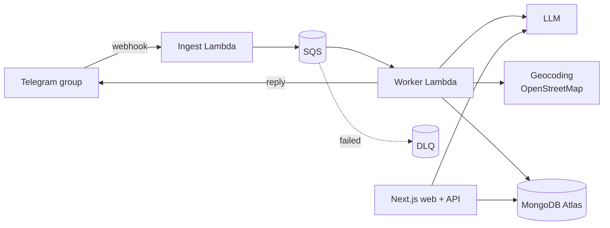

# AnGiDay

> _"Ăn gì đây?"_ — "What should we eat?"

A small AI-assisted system for saving and finding restaurants, built for two people who were tired of digging through a Messenger chat to find "that noodle place someone posted last month".

_Status: planning. Nothing to run yet._

## The problem

- Restaurant recommendations arrive as social media posts, messages, and occasionally a Google Maps link, all forwarded into one group chat.
- Chat search is poor, addresses are often buried in post comments, and there is no way to ask for "Chinese food", "something soupy", or "near here".

## How it works

1. **Collect:** share a Google Maps link (plus an optional note like "bún bò, cheap, near home") into a Telegram group.
2. **Extract:** a bot acknowledges instantly, then a background worker resolves the place, uses an LLM to classify it (cuisine, dish type, price, tags), and saves it. If something is missing, the bot asks back.
3. **Find:** a web app with fast filters for everyday use, plus an AI chatbot for fuzzy questions ("it's raining, what's warm?") that queries real data via tool calling and streams answers with place cards.

## Architecture

Details: [docs/architecture.md](docs/architecture.md). Decisions and trade-offs: [docs/adr/](docs/adr/README.md).

## Tech stack

- **Web & API:** Next.js (App Router), TypeScript, Vercel AI SDK
- **Ingest:** AWS Lambda, SQS (+ DLQ), AWS CDK, SSM Parameter Store
- **Data:** MongoDB Atlas
- **Shared:** zod schemas in a monorepo
- **LLM:** Gemini via the Vercel AI SDK
- **Place data:** parsed from the shared Google Maps link; addresses from OpenStreetMap Nominatim

## Getting started

_TBD._

## Deploy

_TBD._
