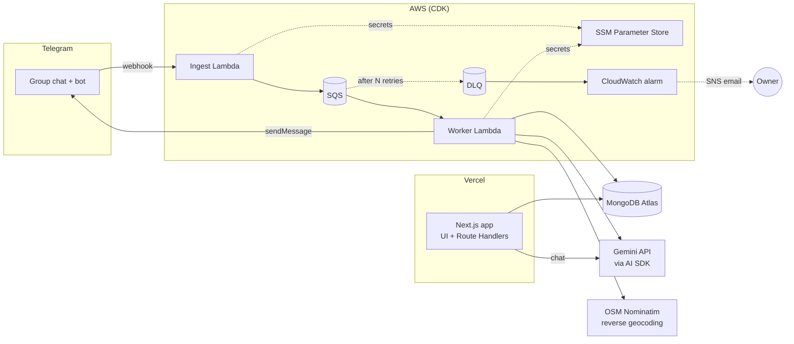
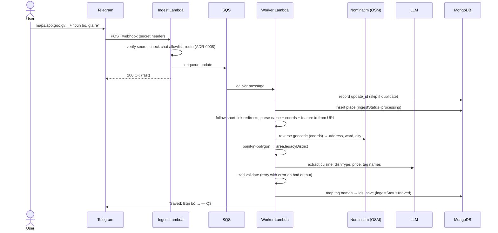
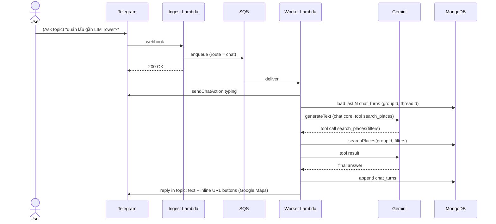

# Architecture

How the system is split into modules, how they talk to each other, and how data flows. The reasons behind each choice are in the [ADRs](adr/README.md).

## System overview

## Modules

| Module | Responsibility | Depends on | Used by |
|---|---|---|---|
| `packages/shared` | zod schemas (Place, Tag, PlaceFilters), taxonomy enums, Vietnamese text normalization | — | everything |
| `packages/ai` | `getModel('extract' \| 'chat')` (the only place naming a provider/model), prompts, extraction call, chat core: system prompt + `search_places` tool + tool loop ([ADR-0009](adr/0009-gemini-via-ai-sdk.md), [ADR-0011](adr/0011-telegram-chat-via-forum-topics.md)) | shared, Vercel AI SDK | web, worker |
| `packages/db` | Mongo client (reused across invocations), repositories for groups/places/tags, `searchPlaces(groupId, filters)` | shared | web, worker |
| `services/ingest` — webhook | Verify Telegram secret, drop unknown chats, enqueue, ack 200 fast | SQS | Telegram |
| `services/ingest` — worker | Resolve Maps link, reverse geocode, LLM extraction, tag mapping, persist, reply in Telegram; Telegram chat adapter (F7) | db, shared, ai, Nominatim, Telegram API | SQS |
| `apps/web` | UI (list, filters, tags, chat) + thin Route Handlers | db, shared, ai | browser |
| `infra` | CDK: Lambdas, SQS, DLQ, alarms, SSM params | — | — |

Rule: handlers stay thin, logic lives in `packages/*` ([ADR-0005](adr/0005-api-in-nextjs-nestjs-later.md)).

Lambda config arrives as SSM parameter *names*, not values: CDK sets each function's env to `<NAME>_PARAM=<ssm-parameter-name>`, and the handler reads the real value from SSM at cold start (`services/ingest/src/lib/lambda-env.ts`), validated with the same `packages/shared` env schema the other runtimes use.

## Data model (intent)

The field-level source of truth is the zod schemas in `packages/shared`. This section only covers structure and indexes.

| Collection | Purpose | Key indexes |
|---|---|---|
| `groups` | Tenant; links a Telegram chat to a group; stores registered topic ids (`saveThreadId`, `askThreadId`) | unique `telegramChatId` |
| `members` | People in a group (Telegram user, display name); used for "added by" and per-person ratings | `{ groupId, telegramUserId }` unique |
| `places` | One saved restaurant | `{ groupId, createdAt }`, `{ groupId, "source.telegramUpdateId" }` unique (idempotent save), `{ groupId, tagIds }` (multikey, later), `{ groupId, "area.legacyDistrict" }` (later), `location` 2dsphere (later) |
| `tags` | Per-group tag registry `{ name, normalized }` | `{ groupId, normalized }` unique |
| `telegram_updates` | Processed update ids for idempotency, scoped per group | `{ groupId, updateId }` unique, TTL 7 days on `createdAt` |
| `chat_turns` | Recent Telegram chat turns per topic, for multi-turn context (Phase 2) | `{ groupId, threadId, createdAt }`, TTL |

A place has **two independent statuses**:
- `ingestStatus`: `processing → needs_info → saved` (or `failed`). This is pipeline state.
- `visitStatus`: `want_to_try | visited`. This is user state.

Every place also stores a `searchText` field (normalized, accent-free) so free-text search is accent-insensitive.

Area: `area: { city, ward, legacyDistrict }`. `ward`/`city` come from OpenStreetMap reverse geocoding as-is ([ADR-0016](adr/0016-place-details-from-url-and-nominatim.md)); `legacyDistrict` (pre-2025 HCMC district) is derived at ingest by point-in-polygon on a static GeoJSON ([ADR-0013](adr/0013-area-legacy-district-from-polygons.md)) from geoBoundaries ADM2 ([ADR-0018](adr/0018-district-polygons-from-geoboundaries.md)); `q2`, `q9` and `thu_duc` are separate keys.

## Flows

### F1. Save a place from a Maps link (Telegram)

### F2. Missing info → ask back

Applies to `/add <text>` without a Maps link ([ADR-0008](adr/0008-explicit-add-command-for-text-only.md)).

1. Worker creates the place with `ingestStatus = needs_info` and keeps the user's text as hints.
2. Bot replies asking for a Maps link and stores its own `message_id` on the place.
3. User **replies to the bot's message** → ingest routes it as a follow-up → worker finds the pending place via `reply_to_message.message_id` (scoped by `groupId`) → merges → continues F1 from the Maps step.
4. Reply still has no link → bot asks again.

`needs_info` places are hidden from the default web list.

### Ingest routing

The ingest Lambda decides cheaply what enters the queue; everything else is dropped with a 200. Topics are optional: without registered topics, the "Save topic" rules apply to the whole group ([ADR-0008](adr/0008-explicit-add-command-for-text-only.md), [ADR-0011](adr/0011-telegram-chat-via-forum-topics.md)).

| Where | Message | Route |
|---|---|---|
| Save topic | Contains a Google Maps URL | F1 |
| Save topic | `/add <text>` without a link | F2 (create `needs_info`) |
| Save topic | `/add` alone | Usage help |
| Save topic | Reply to a bot message | F2 follow-up |
| Ask topic | Any text from a human | F7 (chat) |
| Anywhere | `/ask <question>` | F7 (chat) |
| Anywhere | `/setup save` / `/setup ask` | Register the current topic on the group |
| — | Anything else | Drop |

### F3. Processing failure

1. Worker throws (LLM 429, Maps error, invalid output after retries) → SQS redelivers with backoff.
2. After N attempts → DLQ → CloudWatch alarm.
3. Place marked `failed`; bot posts a short failure notice.

### F4. Browse & filter (web, no AI)

1. Admin logs in (hardcoded credentials → session cookie).
2. Server Component calls `searchPlaces(groupId, filters)`.
3. Filters: cuisine, dish type, area (old district or new ward, via alias table — [ADR-0013](adr/0013-area-legacy-district-from-polygons.md)), price, tags, visit status, free text.
4. Cards link to Google Maps.

### F5. AI chat (web) — Phase 2

1. `POST /api/chat` with the conversation.
2. The chat core in `packages/ai` runs with `streamText`; the LLM calls tool `search_places(filters)`, which runs the same `searchPlaces()` as F4 and is scoped to the group.
3. Response streams back: text + place cards with Maps links.

### F7. AI chat (Telegram) — Phase 2, built before F5

Same chat core as F5; only the adapter differs (no streaming, Telegram formatting). See [ADR-0011](adr/0011-telegram-chat-via-forum-topics.md).

### F6. Manage tags (web)

- Rename → update one tag document.
- Delete → remove from registry; dangling `tagIds` are ignored on read (lazy cleanup).
- Assign/unassign tags on a place.

## Error handling & retries

| Failure | Handling |
|---|---|
| Telegram resends the same update | Idempotency via unique `updateId` |
| LLM returns invalid JSON / schema | Re-prompt with the zod error, max N attempts, then fail |
| LLM 429 (free-tier RPM limit) | Worker: exponential backoff, SQS redelivery as the outer retry. Chat: short retry, then a friendly "busy, try again" message |
| Unknown chat sends to bot | Dropped at ingest |
| Maps URL can't be parsed / has no coordinates | S1 behaviour until S5: reply "chưa đọc được", save nothing; then `needs_info`, ask for a better link ([ADR-0016](adr/0016-place-details-from-url-and-nominatim.md)) |
| Reverse geocoding fails or returns nothing | Save without address/ward/city, log a warning; `legacyDistrict` still comes from polygons |
| Message fails repeatedly | DLQ + alarm; place marked `failed` |

## Observability

See [ADR-0015](adr/0015-testing-and-observability-baseline.md).

- Lambdas log JSON via Powertools Logger; `updateId` is the correlation id across webhook → SQS → worker.
- Metrics (EMF): `PlaceSaved`, `PlaceFailed`, `LlmRetry`, `LlmTokens`, `Llm429`.
- Alarms → SNS → email: DLQ not empty; worker errors.
- Web admin filter shows `failed` / `needs_info` places.

## Open questions

None for Phase 1. New questions go here until they get an ADR.
