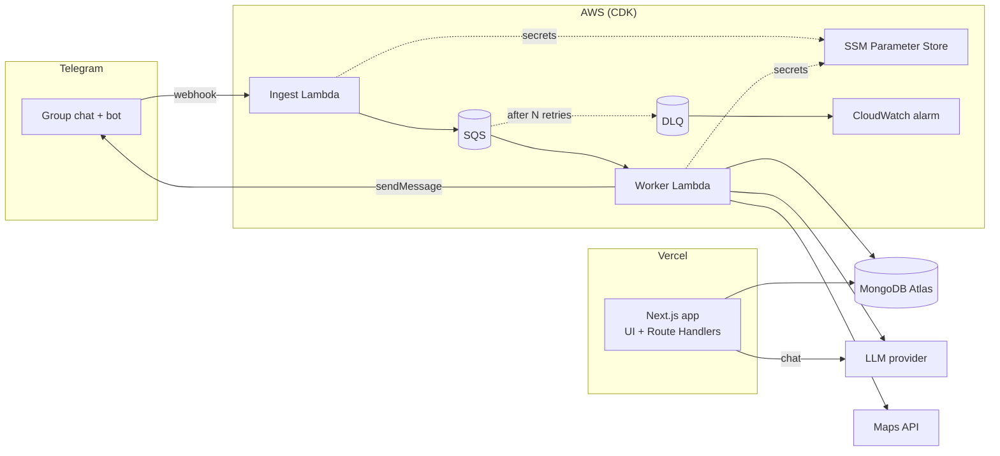
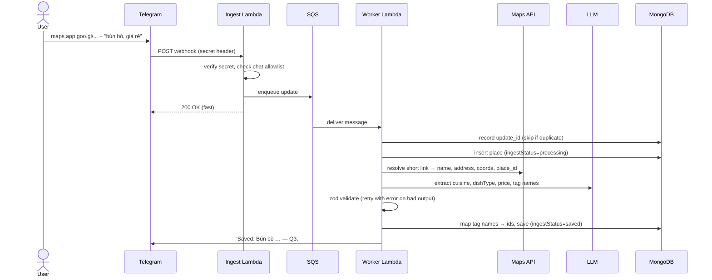

# Architecture

How the system is split into modules, how they talk to each other, and how data flows. The reasons behind each choice are in the [ADRs](adr/README.md).

## System overview

## Modules

| Module | Responsibility | Depends on | Used by |
|---|---|---|---|
| `packages/shared` | zod schemas (Place, Tag, PlaceFilters), taxonomy enums, Vietnamese text normalization | — | everything |
| `packages/db` | Mongo client (reused across invocations), repositories for groups/places/tags, `searchPlaces(groupId, filters)` | shared | web, worker |
| `services/ingest` — webhook | Verify Telegram secret, drop unknown chats, enqueue, ack 200 fast | SQS | Telegram |
| `services/ingest` — worker | Resolve Maps link, LLM extraction, tag mapping, persist, reply in Telegram | db, shared, LLM, Maps, Telegram API | SQS |
| `apps/web` | UI (list, filters, tags, chat) + thin Route Handlers | db, shared, LLM | browser |
| `infra` | CDK: Lambdas, SQS, DLQ, alarms, SSM params | — | — |

Rule: handlers stay thin, logic lives in `packages/*` ([ADR-0005](adr/0005-api-in-nextjs-nestjs-later.md)).

## Data model (intent)

The field-level source of truth is the zod schemas in `packages/shared`. This section only covers structure and indexes.

| Collection | Purpose | Key indexes |
|---|---|---|
| `groups` | Tenant; links a Telegram chat to a group | unique `telegramChatId` |
| `members` | People in a group (Telegram user, display name); used for "added by" and per-person ratings | `{ groupId, telegramUserId }` unique |
| `places` | One saved restaurant | `{ groupId, createdAt }`, `{ groupId, tagIds }` (multikey), `location` 2dsphere (later) |
| `tags` | Per-group tag registry `{ name, normalized }` | `{ groupId, normalized }` unique |
| `telegram_updates` | Processed `update_id`s for idempotency | unique `updateId`, TTL |

A place has **two independent statuses**:
- `ingestStatus`: `processing → needs_info → saved` (or `failed`). This is pipeline state.
- `visitStatus`: `want_to_try | visited`. This is user state.

Every place also stores a `searchText` field (normalized, accent-free) so free-text search is accent-insensitive.

## Flows

### F1. Save a place from a Maps link (Telegram)

### F2. Missing info → ask back

1. Worker can't fill a required field (e.g. no Maps link) → `ingestStatus = needs_info`.
2. Bot replies asking for the missing piece.
3. User **replies to the bot's message** → worker finds the pending place via `reply_to_message` → merges → continues F1 from the Maps step.

_Open: text-only handling (see Open questions)._

### F3. Processing failure

1. Worker throws (LLM 429, Maps error, invalid output after retries) → SQS redelivers with backoff.
2. After N attempts → DLQ → CloudWatch alarm.
3. Place marked `failed`; bot posts a short failure notice.

### F4. Browse & filter (web, no AI)

1. Admin logs in (hardcoded credentials → session cookie).
2. Server Component calls `searchPlaces(groupId, filters)`.
3. Filters: cuisine, dish type, district, price, tags, visit status, free text.
4. Cards link to Google Maps.

### F5. AI chat (web) — Phase 2

1. `POST /api/chat` with the conversation.
2. LLM calls tool `search_places(filters)`, which runs the same `searchPlaces()` as F4 and is scoped to the group.
3. Response streams back: text + place cards with Maps links.

### F6. Manage tags (web)

- Rename → update one tag document.
- Delete → remove from registry; dangling `tagIds` are ignored on read (lazy cleanup).
- Assign/unassign tags on a place.

## Error handling & retries

| Failure | Handling |
|---|---|
| Telegram resends the same update | Idempotency via unique `updateId` |
| LLM returns invalid JSON / schema | Re-prompt with the zod error, max N attempts, then fail |
| LLM 429 | Exponential backoff; SQS redelivery as the outer retry |
| Unknown chat sends to bot | Dropped at ingest |
| Message fails repeatedly | DLQ + alarm; place marked `failed` |

## Open questions

- Text-only message (no Maps link): ask for a link via reply (leaning) vs auto-search with inline buttons.
- LLM provider: Bedrock / Gemini / other.
- Maps API: Google / Goong (Goong can't resolve Google short links directly).
- Cuisine & dish-type taxonomy values.
- Monorepo tooling.
- Testing strategy; observability details.
